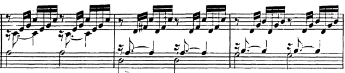
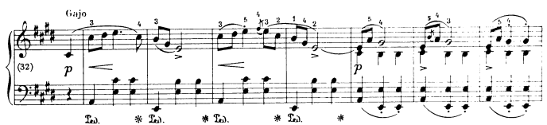
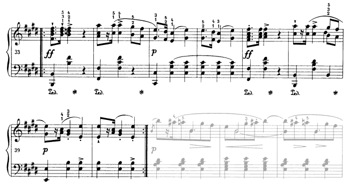
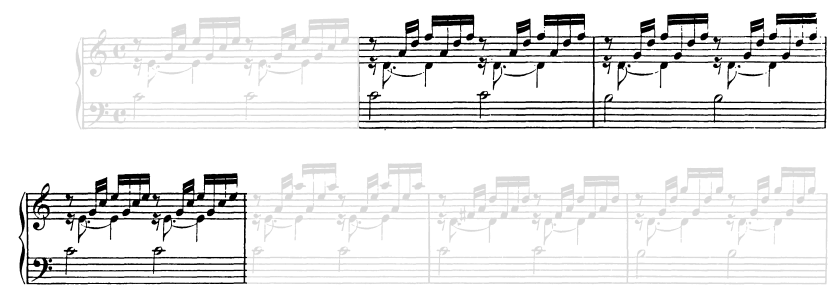

# Neighboring Motions

## Of I

# Resolutions

## To I

### Circle of Fifths 

#### II-V-I

##### $ii^7-V^7-I$

- **Bach JS, BWV 846 m9:** With 5-voice harmony, the doubling of 3rds seems the way to go, except for the leading tone (on V7).

  

### Circle of Fourths

#### IV-I

- **Chopin, op6 n2 m33:** 

   

## To vi

### Circle of Fourths

#### I-V-ii-vi

- **Chopin, op6 n3 m33:** With a bit of chromatic voice leading. There's also a kind of mirror effect: backwards cycling to vi, then forward to I. Voicing: Empty fifths and octaves in the left hand, leaving harmonic space for the melody in parallel sixths. 

   

# Deceptions

# Activations

# Loops

# Prolongations

## Of I

### I-II-V-I

- **Bach JS, BWV 846 m2:** The prolongation feeling is reinforced with the ii's 7th in bass, held over from previous I. Bass does 1-1-7-1, almost pedal like.

  
