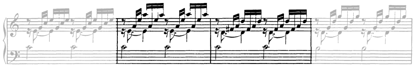
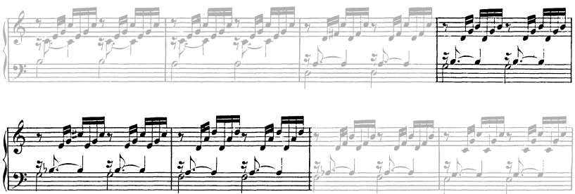
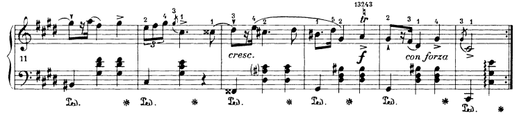
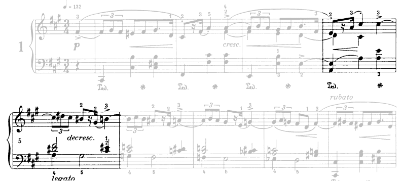
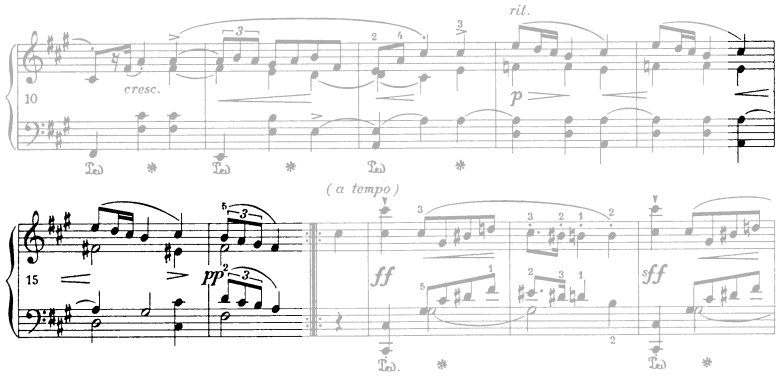

# Pivots

## Up a Fifth

### vi becomes ii

- **Bach JS, BWV 846 m5:** Because of inversions, this pivot is accomplished with minimal bass movement.

   

### I becomes IV

#### In Minor

- **Bach JS, BWV 846 m11:** The are many things at play in this passage. I still feel like this is made smoother by  this chord being coherent as IV of D melodic minor.

  

- **Chopin, op6 n2 m12:** nan 

   

### bIII becomes bVI

- **Chopin, op6 n1 m4:**  

   

## Down a minor third

### IV becomes bVI

- **Chopin, op6 n1 m15:**  

   

