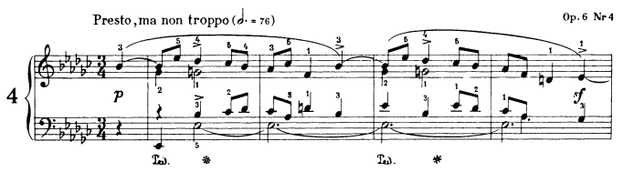
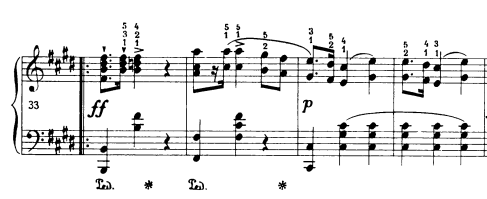
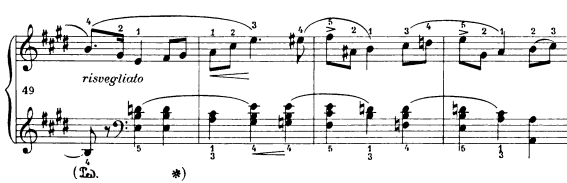
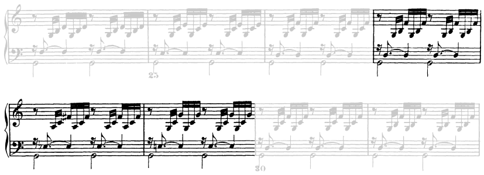
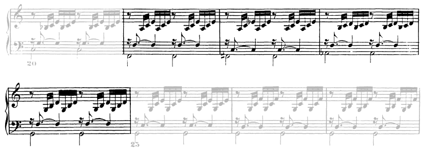
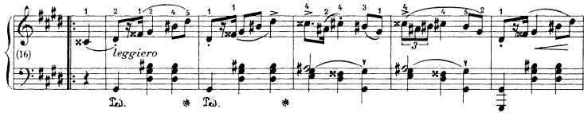

# Chromatic Voice Leadings

## Single Voice

### b3-3-4

#### $i-\[V^7\]-iv$

- **Chopin, op6 n4 m1:** With a tonic pedal. Also note that the b3-3-4 shift is in an ephemeral voice. Also, the crossings between "soprano" and "tenor". 

   

### 6-b6-5

#### $IV-vii^{o7}-i$

- **Bach JS, BWV 846 m11:** In minor, this motion can occur in as part of a modal shift from melodic to harmonic (it is one possible analysis of this passage). The doubled 3rd in the first chord are sent through contrary motion to the 2 diminished neighboring notes. An elegant 5 voice trick.
  
  

### 5-#4-4

- **Chopin, op6 n2 m13:** Even when the pattern doesn't occur in a specific voice, a similar feeling is achieved I think. Voicings: complete drop-2 chords in the left hand over the measures. 

   

### 7-b7-6

#### $V-v-ii$
- **Chopin, op6 n3 m33:** The shift produces a $v = iv(ii)$ pivot. Could also be interpreted as a very brief shift to the mixolydian mode. 

   

### 7-b7-6-b6-5

#### $V-v-\[V^7\]-ii-ii^ø-V^7$

- **Chopin, op6 n3 m50:** This one uses $v$ as pivot to tonicize $ii$. It also creates a 3-chords sequential pattern. The voicing (2 parts in right hand) is worth studying. 

   

## Two Voices

### 4-#4-5 and 2-#2-3

#### $V^7-\[vii^7\]-V^6_4$

- **Bach JS, BWV 846 m27:** On a V pedal.
  
  

### 4-#4-b6-5 and 3-b3-2

#### $IV-vii^7(V)-ii^{ø7}-V^7$

- **Bach JS, BWV 846 m21:** This double motion must be rare in classical settings, but occurs here because of the major 7th on IV, probably to be analysed as full-length suspension from the previous chord. Here also, the $ii^{ø7}$ chord is interposed between the secondary dominant and its target, making it a 2-step resolution to V.

  

### 5-#4-4 and 5-b6-5

#### $I-\[bII^7\]-V^7$

- **Chopin, op6 n2 m18:** By adding a 5-b6-5 to the 5-#4-4 voice leading, a tritone substitution (aka augmented 6th) approach to the dominant is obtained. 

   
