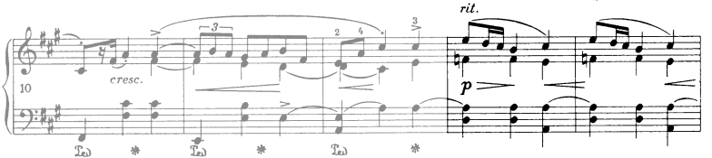

## Major Modes

### Ionian

- **Chopin, op6 n2 m40:** The preceding key and the E pitch prior drag the $C^{\#5}$ on beat 2 to the minor side, which then shifts to major on the following measure. This chord is also retrospectively a $IV$. We could say this is a shift pivot: $iv$ becomes $IV$ through a b3-3 minor-major shift. The move overall feels deliberately jarring and accented. It's then smoothened by the repetition of the phrase. 

   

## Minor Melodic Modes

### Mixolydian b6

- **Chopin, op6 n1 m12:** This passage brings a new color, and is in sharp contrast with the parallel measures in the antecedent: a new melodic motive, a new mode, the added 9th, a relatively static harmony. Voincing: drop-24 

   

