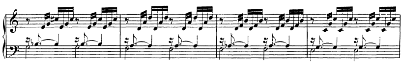
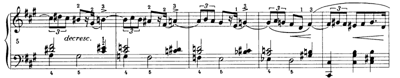
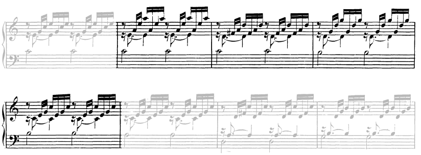
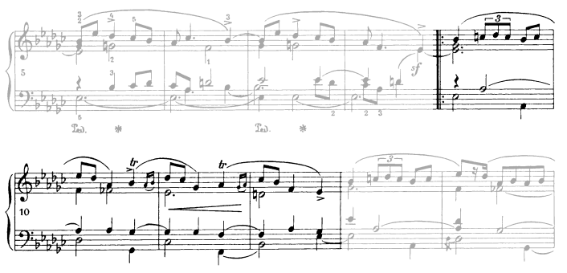
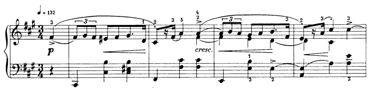

# Descending 2nd

## D2(D5D5)

### Tonicized Steps

#### $\[vii^7\]-ii-\[vii^7\]-I$

 - **Bach JS, BWV 846 m12:**

   

### Steps with chromatic shifts

### Dominant Cycles

- **Chopin, op6 n1 m5:** An iconic descending chromatic voice leading. It's a dominant cycle but with lots of decoration. On beat 1, an inverted $ii^{ø7}$ of the following $V^7$ on beat 2, that can also be analysed as a dominant with 4-3 and 2-1 suspension. On beat 3, the following dominant (only in the first measure... why?) or diminished chord in the cycle. The harmonic rythm is uneven and has a feeling of metric displacement, in line with the Mazurka accentuations. The sequence spans a tritone from beginning to end, starting on V of V and ending on the related $bVI$, then inverted $ii^{ø7}$ of f# (an example of de-escalating tension?), resolving to $V^7$. The whole could be seen as a fancy pre-dominant extrapolation. The drop-2 voicings throughout give space to the melody, and make the 3 other voices comfortable to play in the left hand. 

   

### Uneven Tonicizations

#### $vi-\[V^7\]-V^7-I$

 - **Bach JS, BWV 846 m5:** The final chord with the 7th in the bass is worthy of notice. This is smootly handled by the voice leading.

   

#### $\[ii-V\]-VII-\[ii-V\]-bVI-ii^7-V^7-i$

- **Chopin, op6 n4 m9:** A mix of previously seen treatments. m1: $i$ becomes $ii$ followed by secondary dominant. m2: $I$ becomes $ii$ through 3-b3 shift. m3: diatonic $bVI-ii^7$. 

   

# Rising 3rd

## A3(D5D2)

### $V^7-i-\[V\^7]-III$

- **Chopin, op6 n1 m1:**  With 4-3 suspensions on the dominant chords (m1, m3). It's interesting how the treatment changes in m3-4 compared to m1-2. A new secondary voice in the right hand introduces an additional 2-1 suspension in m3 4-3 suspension in m4. 

   
